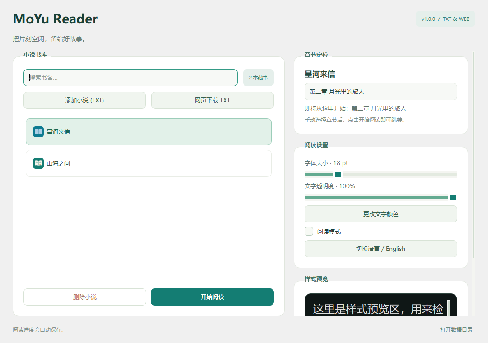

# MoYu Reader · 摸鱼看小说 🐟

面向 Windows 的桌面 TXT 小说阅读器。常驻系统托盘，支持置顶阅读、透明文字、章节跳转、阅读进度保存，以及网页小说下载入库。

使用 **Python 3.9+ · PyQt6 · Requests · BeautifulSoup4 · Chardet** 构建。

**直接使用：** [下载 Windows 64 位免安装包](https://github.com/Liujifa/Mess-Around/releases/latest)。无需安装 Python，完整解压后双击 `MoYuReader.exe`。



[快速开始](#快速开始) · [阅读指南](#阅读指南) · [网页下载](#网页下载) · [数据与备份](#数据与备份) · [常见问题](#常见问题) · [开发与测试](#开发与测试)

## 功能一览

| 功能 | 说明 |
| --- | --- |
| 本地阅读 | 导入 TXT，自动检测编码，识别中文和英文章节标题 |
| 章节定位 | 书库选章后开始阅读；手动选章优先于旧进度，长篇文件等待布局完成后定位 |
| 阅读模式 | 置顶窗口、透明背景和文字；鼠标移出阅读窗口时隐藏文字，移入恢复 |
| 阅读设置 | 调整字号、文字颜色和透明度，支持中英文界面 |
| 进度保存 | 保存阅读位置和滚动比例；使用原子写入，失败时保留原书库 |
| 通用下载 | 按页面结构识别 HTML / JSON 目录和正文，支持 TXT、分页、手动 CSS 规则、限速、重试和缓存续传 |
| 章节索引 | 下载时生成精确目录，减少正文小标题被误识别的情况 |
| 资源复用 | 同一本书未修改时复用已加载文档；切书时释放旧目录动作 |

## 快速开始

### 方式一：下载免安装包（推荐）

1. 打开 [Releases](https://github.com/Liujifa/Mess-Around/releases/latest)，下载 `MoYuReader-v1.0.0-Windows-x64.zip`。
2. 完整解压 ZIP 到本地目录，双击 `MoYuReader.exe`。请保留旁边的 `_internal` 文件夹，不要在压缩软件内部运行。
3. 启动后直接显示书库。导入 TXT 或从网页下载，选择章节后点击 **开始阅读**。

适用于 **Windows 10 / 11，64 位**。发布包附带 SHA-256 校验文件和第三方组件许可证；GitHub 自动生成的 `Source code` 压缩包是源码，不含可直接运行的 EXE。

### 方式二：Windows 源码一键启动

1. [下载项目 ZIP](https://github.com/Liujifa/Mess-Around/archive/refs/heads/main.zip)，并解压到可写的目录。
2. 安装 **Python 3.9 或更高版本**，安装时启用 **Add Python to PATH**。
3. 双击 `StartReader.bat`。脚本会检查 Python、pip 和所需依赖，缺少依赖时尝试安装。
4. 程序启动后显示书库，并常驻系统托盘。关闭书库后，可**双击托盘图标**，或右键选择 **打开书库 / Library**，重新打开。

首次安装依赖需要联网。关闭书库后程序仍在托盘运行；完全退出请选择托盘菜单中的 **退出 / Quit**。

### 方式三：从源码运行

```powershell
git clone https://github.com/Liujifa/Mess-Around.git
cd Mess-Around
python -m pip install -r requirements.txt
python main.py
```

Windows 上也可以双击 `main.pyw` 进行无控制台启动；它与 `main.py` 共用启动逻辑，运行前需要安装好依赖。

## 阅读指南

1. 在书库点击 **添加小说 (TXT)**，选择本地文件。
2. 选中小说，在 **章节定位** 中选择目标章节，再点击 **开始阅读**。未手动选章时继续上次进度。
3. 阅读窗口的 **目录** 菜单可直接跳章，**A+ / A-** 调整字号，鼠标滚轮滚动正文。
4. 在书库勾选 **阅读模式**，或使用阅读窗口顶部的模式按钮，进入透明阅读模式。
5. 透明模式会隐藏顶部工具栏。需要恢复普通模式时，从托盘打开 **Library**，取消勾选 **阅读模式**。

书库右侧可以调整文字颜色和透明度，并查看预览。阅读窗口顶部的 **X** 会隐藏阅读窗口；要完全退出，请右键托盘图标选择 **Quit**。

书库支持按书名搜索，设置旁会显示当前字号和透明度。无选中书籍时阅读和删除按钮自动禁用。右侧设置区与下载表单支持滚动，展开高级规则后操作按钮仍固定在窗口底部。普通阅读模式可拖动顶部区域移动窗口，拖动右下角调整大小。

## 网页下载

在书库点击 **网页下载 TXT**，粘贴小说详情页、目录页、阅读页或 TXT 地址，按需填写书名，然后点击 **下载并入库**。成功后会自动加入书库，并显示实际下载的章节数。

### 通用识别方式

下载器根据页面内容和链接关系工作，通用解析不要求站点在域名白名单内。

| 页面形式 | 识别方式 |
| --- | --- |
| HTML 目录 | 根据链接分组、路径和目录结构发现章节，支持无编号标题和多卷目录，过滤导航与推荐书 |
| 详情页或下载页 | 沿实际目录、开始阅读等入口寻找目录；没有目录时尝试 TXT 下载链接 |
| 目录分页 | 识别分页路径、查询参数、下一页链接、数字分页和下拉选项，并保留书籍标识 |
| 内嵌 JSON | 读取 JSON-LD、`application/json`、`__NEXT_DATA__` 中的章节列表和正文，不执行脚本 |
| JSON 接口 | 支持直接输入包含章节 URL 列表或 `chapterContent`、`articleBody` 等字段的接口地址 |
| HTML 正文 | 对正文容器评分、过滤链接密集区域并合并章节分页；保留已有部分 AJAX 正文兼容逻辑 |
| TXT 文件 | 支持直接地址、页面下载链接、文本 MIME 类型及 TXT 附件响应，自动检测编码并生成章节索引 |

相对链接使用重定向后的页面地址解析。目录保留原站顺序，仅在编号明确连续倒序时反转，避免打乱多卷重编号或特殊章节。普通 TXT 的分章仍依赖标题识别，可能需要人工校对。

原有字符解码及个别站点的兼容回退继续保留，通用目录发现不依赖这些适配。没有找到目录时，下载器会明确提示尝试下载当前阅读页；不会把单页下载描述为整本下载。

### 高级解析规则

遇到特殊页面结构，可以展开下载窗口的 **高级解析规则（可选）**，按需填写 CSS 选择器。留空的字段继续自动识别，规则仅用于本次下载，无需修改代码或添加站点适配。

| 字段 | 示例 | 用途 |
| --- | --- | --- |
| 目录入口 | `a[href*="catalog"]` | 从详情页找到目录 |
| 章节链接 | `.chapter-list a` | 指定目录中的章节链接 |
| 目录下一页 | `.pagination a[rel="next"]` | 指定目录翻页入口 |
| 正文 | `#content` | 指定章节正文容器 |
| 正文下一页 | `a.next-page` | 指定同一章的下一页 |
| 书名 | `h1` | 指定书名所在元素 |

选择器需要匹配实际 HTML 中的元素。无效选择器、指定的章节链接未匹配或目录分页缺失章节时会报告错误。规则应选择当前书籍的链接，避免包含推荐内容。

**动态页面的边界：** 程序不会运行任意 JavaScript。如果正文只在浏览器执行脚本后才出现，原始 HTML 和内嵌 JSON 均不含正文，需要提供可访问的数据接口或另行使用浏览器渲染。CSS 规则无法提取响应中不存在的数据；登录、验证码和接口鉴权也可能限制下载。

### 完整性、重试与取消

- 通用下载使用共享限速；收到 HTTP 429 时统一冷却，降低请求频率。
- 失败章节会额外重试一轮。仍有缺章、分页缺正文、分页循环或超出分页上限时会报告失败，避免把残缺 TXT 作为成功下载入库。
- 已完成章节保存在 `novel_downloads/.chapter_cache/`。使用同一地址重新下载可复用有效缓存；完整保存成功后清理本次缓存。
- 点击取消，或下载时从托盘退出，都会先请求取消，再等待当前网络请求和工作线程结束。
- 正文清洗会保留包含“收藏、评论”等词的正常段落，以及作者有意重复的段落。旧版清洗缓存会失效并重新抓取，已保存的 TXT 不会自动改写。

### Cookie 导入

部分站点需要登录状态。下载对话框支持尝试从 Edge、Chrome、Firefox 导入 Cookie，也支持导入导出的 JSON / Netscape Cookie 文件。

遇到 403 时，先在浏览器中确认该页面能够正常访问，再按 [Cookie 导出说明](cookie_export_guide.md) 导入对应站点的 Cookie。浏览器加密方式、文件占用及站点访问策略都可能影响导入结果。

## 数据与备份

| 文件或目录 | 用途 |
| --- | --- |
| `library.json` | 数据目录中的个人书库、阅读进度与全局设置；首次保存时创建 |
| `novel_downloads/*.txt` | 网页下载生成的小说正文 |
| `小说名.txt.chapters.json` | 对应 TXT 的章节标题、行号与 SHA-256 校验信息 |
| `novel_downloads/.chapter_cache/` | 尚未完成下载的章节缓存，可以删除后重新抓取 |
| `charset.json` | 部分网页正文的字符解码配置 |

建议在退出软件后备份 `library.json` 和小说文件；移动下载 TXT 时一起移动对应的 `.chapters.json`。

**数据目录：** 免安装 EXE 使用 `%LOCALAPPDATA%\MoYuReader`；源码运行继续使用项目目录，兼容已有书库。点击书库底部的 **打开数据目录** 可直接访问。升级时替换程序文件不会覆盖独立保存的用户数据。开发和自检可通过环境变量 `MOYU_DATA_DIR` 指定独立数据目录。

从源码版迁移到 EXE 时，先退出两个版本，再复制原 `library.json` 和 `novel_downloads` 到新数据目录。本地 TXT 请保留原路径；书库中的绝对路径不会自动改写，原小说位置改变时需要重新导入。

**书库记录的是文件路径。** 单独移动小说后，旧书库条目可能失效，需要重新导入；不会自动迁移旧条目的阅读进度。删除书库条目只移除记录，不删除原始 TXT。

书库保存使用同目录临时文件，写入并落盘后再原子替换。损坏的书库会提示错误并停止启动，保留原文件供恢复。个人书库、后续下载文件和缓存默认由 `.gitignore` 排除。

## 常见问题

### 选了章节，为什么还显示开头？

新版已处理手动选章被旧滚动比例、延迟进度保存和长篇文档布局覆盖的问题。更新后先退出托盘里的旧进程，再重新启动；重新选择章节并点击 **开始阅读**。长篇文件首次加载可能需要稍候。

### 目录出现正文里的“第一章……”？

新下载优先使用随附的章节索引。索引缺失、校验失败或 TXT 被编辑后，会回退文本识别。旧版下载文件在章节边界数量与声明一致时，也会尝试从文件结构恢复目录。普通 TXT 的启发式识别仍可能出现误判。

### 下载失败后要从头开始吗？

通用网页下载会保留已成功章节的缓存。输入同一地址重试即可继续。需要完全重新抓取时，先停止下载，再删除 `novel_downloads/.chapter_cache/`。

### 提示书库无法读取或保存？

先退出软件并备份原来的 `library.json`。检查项目目录是否可写、磁盘空间是否充足，以及文件是否损坏；有备份时优先恢复备份。软件不会把损坏的书库当成空书库覆盖，也不会在 TXT 读取失败时重置该书进度。

### 阅读模式下看不到文字？

将鼠标移入阅读窗口，并检查书库中的文字颜色和透明度。阅读模式会隐藏工具栏；可以从托盘打开 **Library** 修改设置或退出阅读模式。

## 开发与测试

### 离线回归测试

```powershell
python -m unittest discover -v
```

测试使用临时文件和无界面 Qt，不修改个人书库，也不访问外部网络，覆盖：

- 选章优先级、长篇延迟布局、同名书籍与 Unicode 偏移；
- 目录分页、正文清洗、缺章重试、缓存续传和索引校验；
- 任意域名目录发现、多卷与无编号章节、HTML / JSON / TXT、重定向、手动规则及规则向工作线程传递；
- 下载线程取消、重试与托盘安全退出；
- 书库原子保存、磁盘故障回滚、旧数据兼容与损坏文件保护；
- 文档复用、目录动作释放和读取失败后的状态保留。
- 书库搜索、空状态、语言切换后的手动选章、短窗口表单滚动，以及发布版数据目录隔离。

其中 `test_core_behaviors.py` 覆盖基础流程，`test_review_regressions.py` 覆盖审查中发现的异常路径，`test_generic_downloader.py` 覆盖通用解析与下载规则，`test_ui_release.py` 覆盖界面与发布路径。

### 构建 Windows 发布包

在 Windows x64 / Python 3.13 环境运行：

```powershell
python -m venv .venv-build
.\.venv-build\Scripts\python.exe -m pip install -r requirements-build.txt
.\.venv-build\Scripts\python.exe -m unittest discover -v
.\.venv-build\Scripts\python.exe build_release.py
```

产物位于 `release-artifacts/`，包括 ZIP 与 `SHA256SUMS.txt`。`MoYuReader.spec` 只收集明确指定的资源，不打包个人书库、小说或 Cookie；`requirements-build.txt` 锁定发布依赖。

解压产物后可运行自检：

```powershell
.\MoYuReader\MoYuReader.exe --smoke-test C:\Temp\MoYuSmoke
```

自检使用临时数据和本地 HTTP 服务，验证窗口、章节跳转、下载、索引与保存，并在指定目录输出截图及 `smoke-result.json`；不会联网下载小说或修改个人书库。发布版的界面截图、检查结果和构建步骤见 [发布说明](packaging/README.md)。

### 在线目录检查

```powershell
python test_bqg5.py
python test_bqg5.py https://example.com/novel/catalog
python test_bqg5.py https://example.com/novel/catalog --chapter-links ".chapters a" --next-page "a.more"
```

脚本保留历史文件名，支持传入任意目录地址与可选 CSS 规则。以上 `example.com` 地址仅为命令示例。仅在显式运行时访问站点；被测试框架导入时不会联网。在线结果受站点可用性和页面结构变化影响。

### 主要模块

| 模块 | 职责 |
| --- | --- |
| `main.py` / `main.pyw` | 统一启动入口、窗口信号连接、托盘与退出流程 |
| `library_view.py` | 书库界面、章节选择与阅读设置 |
| `library_manager.py` | 书库加载、原子保存及写入失败回滚 |
| `reader_logic.py` | 编码检测、章节解析、索引校验与缓存 |
| `reader_window.py` | 阅读窗口、位置恢复、进度保存与文档复用 |
| `download_dialog.py` | 下载界面与 Qt 工作线程生命周期 |
| `web_novel_downloader.py` | 目录与正文抓取、分页、限速、重试及 TXT 输出 |
| `novel_page_parser.py` | 通用目录发现、链接分组、分页识别、结构化数据与 CSS 规则 |
| `browser_cookie_importer.py` | 浏览器与文件 Cookie 导入 |
| `styles.py` | 书库和阅读器样式 |
| `app_paths.py` | 应用版本、只读资源和可写数据目录 |
| `build_release.py` / `MoYuReader.spec` | Windows EXE 构建、许可证收集、ZIP 与校验文件 |

## 许可与内容

项目代码许可见 [LICENSE](LICENSE)。小说内容的版权归相应权利人所有；请遵守站点规则，仅下载和使用有权访问的内容。提交代码时不要上传个人书库、小说正文或 Cookie 文件。
